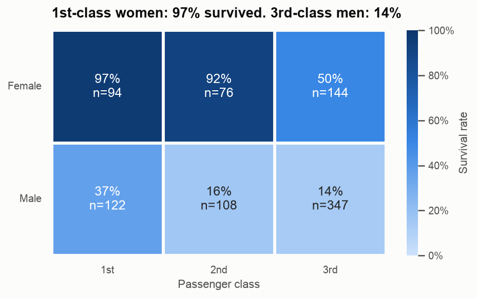
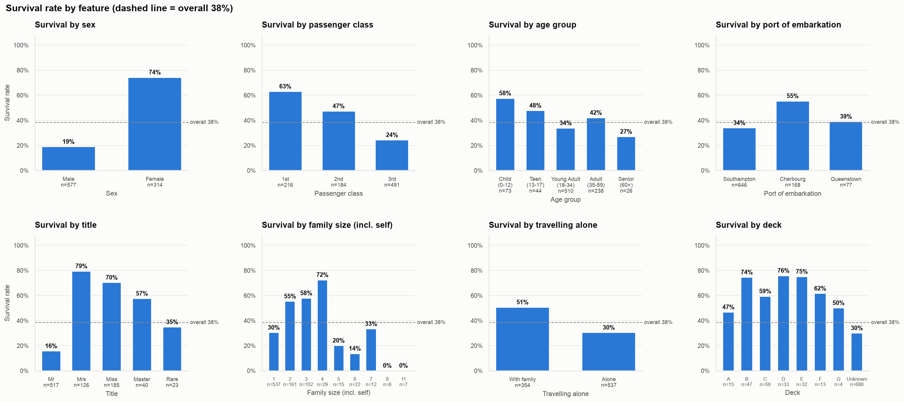
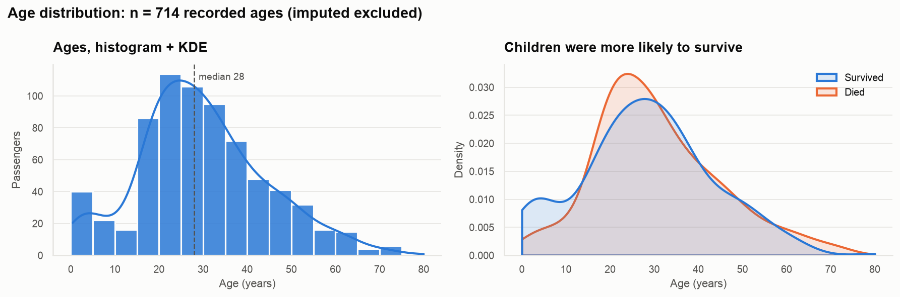
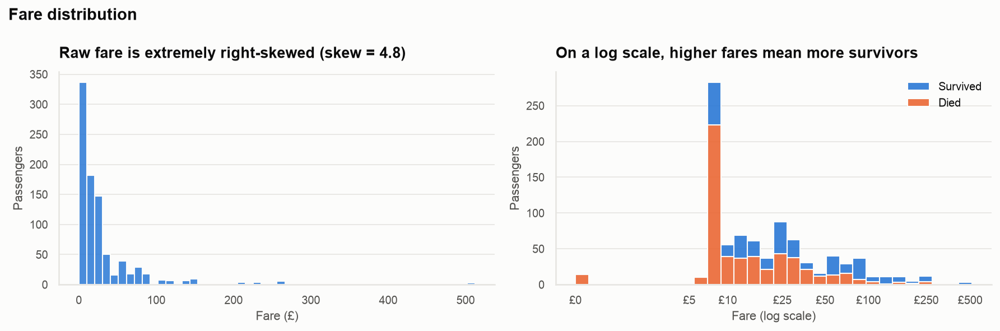
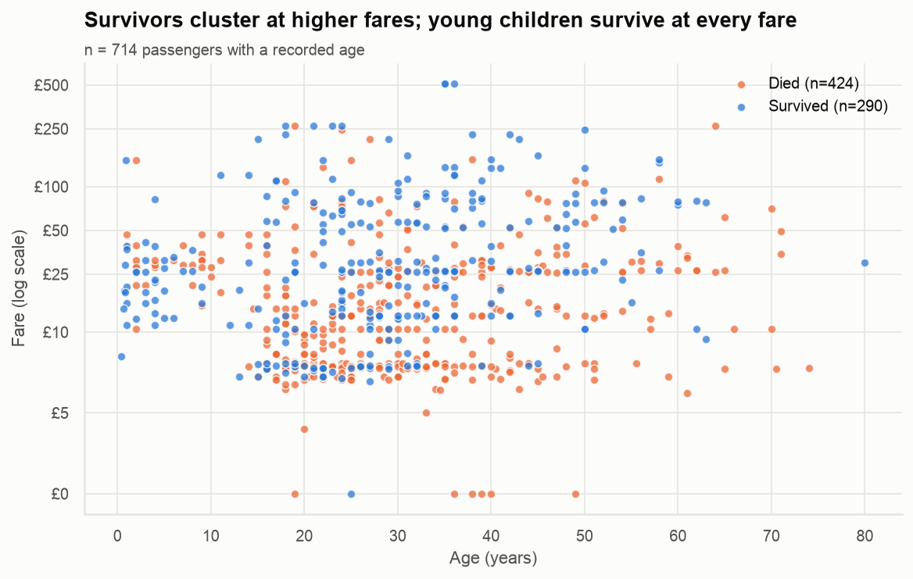
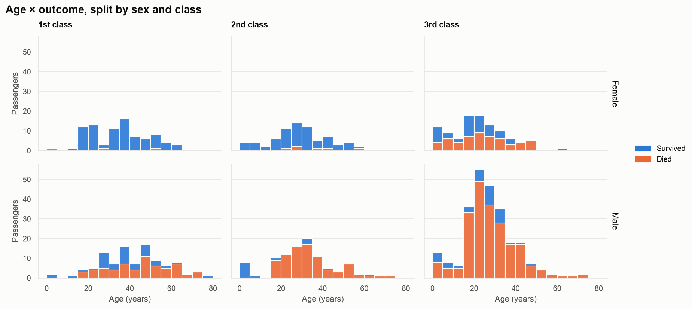
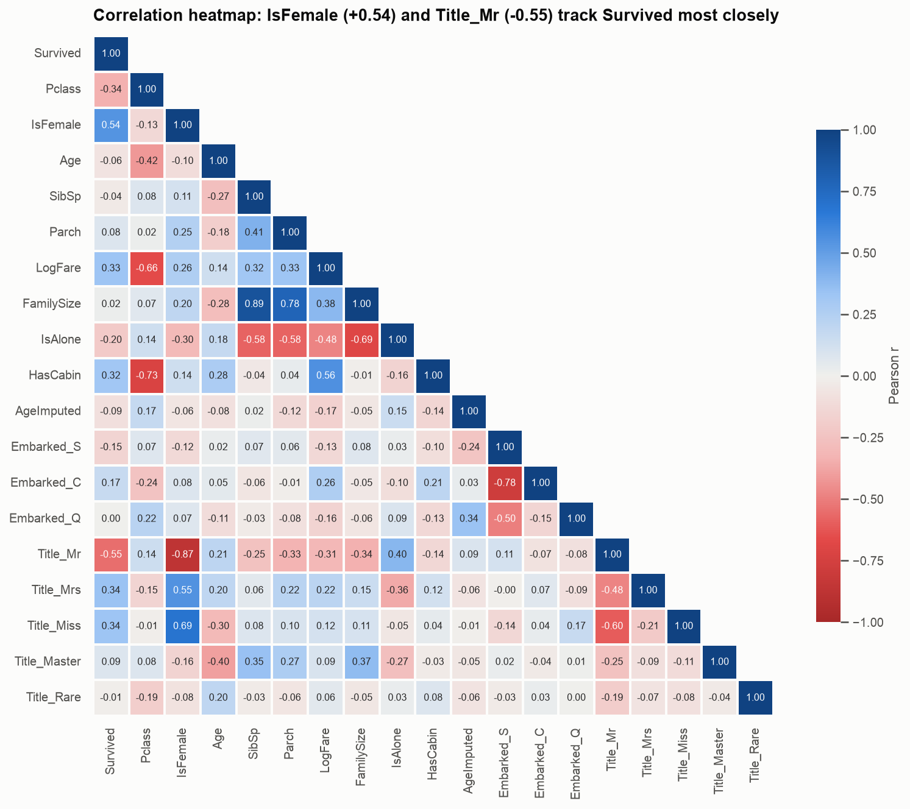
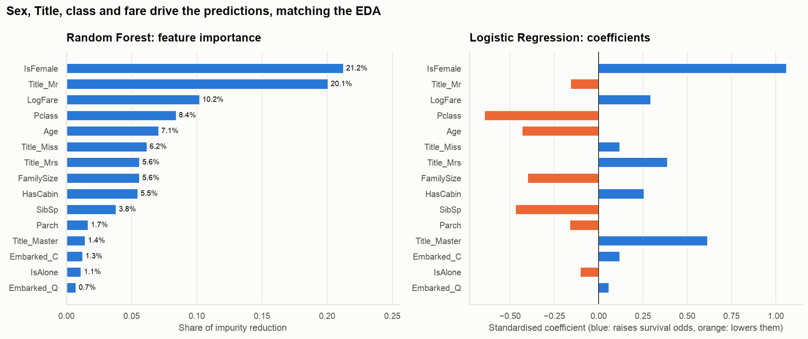

# 🛟 Lifeboat Ledger

> **Who survived the Titanic, and why?** Data cleaning, feature engineering and exploratory data analysis of the Titanic passenger list.
>
> **Prodigy InfoTech Data Science Internship – Task 02**

   

<p align="center"></p>

---

## 📌 Overview

**Task:** perform data cleaning and exploratory data analysis (EDA) on the Titanic dataset, explore the relationships between variables, and identify patterns and trends.

Lifeboat Ledger is a reproducible pipeline (`src/`) plus a storytelling notebook that walks through the analysis as **Question → Chart → Insight**:

1. **Inspect** the raw files (shape, dtypes, nulls, duplicates, value counts)
2. **Clean** with every decision documented and justified, learning fill values from the training set only
3. **Engineer** features: Title, FamilySize, IsAlone, AgeGroup, FareBand, Deck
4. **Explore** with 17 charts across univariate, bivariate and multivariate views
5. **Test** the patterns statistically (chi-square, Welch's t, Mann-Whitney U), with p-values explained in plain English
6. **Validate** with quick baseline models showing that the engineered features carry predictive signal

## 📂 Dataset

The Titanic passenger data from the [Prodigy InfoTech dataset repository](https://github.com/Prodigy-InfoTech/data-science-datasets/tree/main/Task%202):

| File | Rows × Cols | Description |
|---|---|---|
| `train.csv` | 891 × 12 | Passengers with the `Survived` label, used for all EDA |
| `test.csv` | 418 × 11 | Passengers without the label, cleaned with train-learned rules |
| `gender_submission.csv` | 418 × 2 | Kaggle's "all women survive" example submission |

Key columns: `Survived` (0/1), `Pclass` (1–3), `Sex`, `Age`, `SibSp` (siblings/spouses aboard), `Parch` (parents/children aboard), `Fare`, `Cabin`, `Embarked` (S = Southampton, C = Cherbourg, Q = Queenstown).

## 🧹 Cleaning decisions

| Issue | Scale | Decision | Why |
|---|---|---|---|
| Duplicates | 0 rows / 0 IDs | Verified; the pipeline raises an error if any appear | Duplicates would double-count passengers |
| `Embarked` missing | 2 (train) | Fill with mode **"S"** | Only 2 rows; 72% boarded at Southampton, and historical records confirm these two passengers did too |
| `Fare` missing | 1 (test) | Fill with the **Pclass median** (£8.05, 3rd class) | Fare is driven by class; the overall mean (£32) is inflated by luxury tickets |
| `Age` missing | 177 train + 86 test | Fill with the **Title × Pclass median** (falling back to the Title median); add an `AgeImputed` flag | Title predicts age ("Master" = boys) and so does class; a global median would flatten 20% of rows to 28 |
| `Cabin` missing | 77% | Create **`HasCabin`** + **`Deck`** letter ("U" = unknown, including the single deck-T cabin), then drop `Cabin` | Too sparse to impute, but whether a cabin was recorded, and its deck, carry signal |
| `Fare` outliers | 116 above £65.63 (IQR) | **Keep**; add `LogFare` (log1p) and a `FareZero` flag | Real 1st-class tickets: capping would erase the wealth signal we're studying |
| `Age` outliers | 11 above 64.8 (IQR) | **Keep** | Ages 65–80 are plausible, not data errors |
| Dtypes | n/a | `Pclass` → ordered category; `Sex`/`Embarked`/`Deck` → category; flags → int8 | Makes category order explicit and prevents arithmetic on labels |

> All fill statistics are computed on **train only** and applied to test. The full log is saved to [`data/processed/cleaning_log.csv`](data/processed/cleaning_log.csv).

## 🛠️ Engineered features

| Feature | Definition | Survival range in train |
|---|---|---|
| `Title` | Mr / Mrs / Miss / Master / Rare from `Name` | Mr 16% → Mrs 79% |
| `FamilySize` | `SibSp + Parch + 1` | 0% (size 8+) → 72% (size 4) |
| `IsAlone` | `FamilySize == 1` | 30% alone vs 51% with family |
| `FamilyGroup` | Alone / Small (2-4) / Large (5+) | 16% → 58% |
| `AgeGroup` | Child / Teen / Young Adult / Adult / Senior | 27% (60+) → 58% (0-12) |
| `FareBand` | Training fare quartiles | 20% (Low) → 58% (Very High) |
| `Deck`, `HasCabin` | Cabin letter / cabin recorded | 30% (unknown) → 76% (deck D) |

## 🔑 Key insights

1. **Only 38.4% survived.** 342 of 891 passengers in the training set.
2. **Sex was the strongest factor.** 74% of women survived against 19% of men (χ² p ≈ 10⁻⁵⁸, Cramér's V = 0.54).
3. **Class created a steep gradient.** 63% in 1st, 47% in 2nd and 24% in 3rd class.
4. **Sex × class tells the full story.** **1st-class women survived at ~97%**, but 3rd-class women only at 50%, and 3rd-class men at just 14%.
5. **"Children first" was real but limited.** Children under 13 survived at 58%. Every boy ("Master") in 1st and 2nd class survived, compared with 39% in 3rd.
6. **Title is the single best feature** (V = 0.57). Mrs 79%, Miss 70%, Master 57%, Mr 16%.
7. **Money bought survival.** Survivors' median fare was £26 against £10.50 for those who died (Mann-Whitney p ≈ 10⁻²²).
8. **Family size is U-shaped.** Small families (2–4) survived at 58%, solo travellers at 30%, and large families at only 16%.
9. **Cherbourg's 55% is a class illusion.** 51% of Cherbourg passengers were in 1st class, compared with 3% from Queenstown.
10. **Average age hides the age effect.** Median age was 28 for both groups (p = 0.16), yet age *groups* differ significantly: the effect lives at the extremes.

## 📊 Charts

<table>
<tr>
<td></td>
</tr>
<tr><td align="center"><em>Survival rate by every key feature. The dashed line marks the overall 38%.</em></td></tr>
</table>

| | |
|---|---|
|  |  |
| *Children (< 12) are the one age band where survivors outnumber the dead* | *Survival rises with fare on a log scale* |
|  |  |
| *Survivors cluster above ~£50 at every age* | *Age × outcome split by sex and class* |
|  |  |
| *Sex and Title_Mr correlate most strongly with survival; class, fare and cabin are intercorrelated* | *Baseline models rank the same drivers as the EDA* |

All 17 figures are in [`reports/figures/`](reports/figures/).

## 🧪 Statistical tests

| Test | Feature(s) | Result |
|---|---|---|
| Chi-square + Cramér's V | Title, Sex | p < 10⁻⁵⁸, **large** effects (V = 0.57, 0.54) |
| Chi-square + Cramér's V | Pclass, Deck, HasCabin, FareBand | p < 10⁻¹⁶, medium effects (V ≈ 0.30–0.34) |
| Chi-square + Cramér's V | FamilyGroup, IsAlone, Embarked, AgeGroup | p < 0.001, small effects (V = 0.15–0.29) |
| Mann-Whitney U | Fare | p ≈ 5 × 10⁻²²: survivors paid much more (r = 0.38) |
| Mann-Whitney U / Welch's t | Age (recorded only) | p = 0.16 / 0.04: no meaningful difference in the overall distribution |

Full results: [`reports/chi_square_tests.csv`](reports/chi_square_tests.csv), [`reports/numeric_tests.csv`](reports/numeric_tests.csv).

## 🤖 Bonus: baseline models

Stratified 5-fold cross-validated accuracy on the training set:

| Model | Raw features (6) | + Engineered features (15) |
|---|---|---|
| "All women survive" rule | 78.7% | n/a |
| Logistic Regression | 80.6% | **82.9%** |
| Random Forest | 83.0% | **83.3%** |

The engineered features lift Logistic Regression by ~2.4 points and reduce variance across folds for both models. Note that `IsFemale` and the `Title_*` columns overlap, so read individual LR coefficients as directions rather than exact effect sizes.

## 🚀 How to run

```bash
git clone https://github.com/VaishnavK9/LifeboatLedger.git
cd LifeboatLedger
python -m venv .venv && source .venv/bin/activate   # Windows: .venv\Scripts\activate
pip install -r requirements.txt
```

Run the pipeline step by step (each step writes its outputs):

```bash
python -m src.data_loader      # inspection report
python -m src.cleaning         # → data/processed/{train,test}_clean.csv + cleaning_log.csv
python -m src.features         # → data/processed/{train,test}_features.csv
python -m src.eda              # → reports/figures/*.png + statistical test CSVs
python -m src.model_baseline   # → model results + feature importance
```

Or open the notebook, which runs everything in story order:

```bash
jupyter notebook notebooks/LifeboatLedger_EDA.ipynb
```

> **Optional profiling report:** `ydata-profiling` doesn't support Python 3.14 yet. On Python ≤ 3.13, `pip install ydata-profiling` and the notebook's §7 cell will write `reports/titanic_profile.html`.

## 🗂️ Project structure

```
LifeboatLedger/
├── data/
│   ├── raw/                  # original CSVs (train, test, gender_submission)
│   └── processed/            # cleaned + featured data, cleaning log
├── notebooks/
│   └── LifeboatLedger_EDA.ipynb
├── reports/
│   ├── figures/              # 17 PNG charts
│   └── *.csv                 # statistical tests, model results, feature importance
├── src/
│   ├── __init__.py           # shared paths
│   ├── data_loader.py        # loading + inspection
│   ├── cleaning.py           # imputation, outliers, dtypes, decision log
│   ├── features.py           # feature engineering + numeric encoding
│   ├── eda.py                # charts + statistical tests
│   └── model_baseline.py     # Logistic Regression + Random Forest
├── requirements.txt
├── LICENSE
└── README.md
```

## 🧰 Tech stack

**Python 3.14** · pandas · NumPy · Matplotlib · seaborn · SciPy · scikit-learn · Jupyter

## 👤 Author

**Vaishnav Kumbhar**
GitHub: [@VaishnavK9](https://github.com/VaishnavK9)

Built as **Task 02** of the **Prodigy InfoTech Data Science Internship**.

## 📄 License

Released under the [MIT License](LICENSE).
